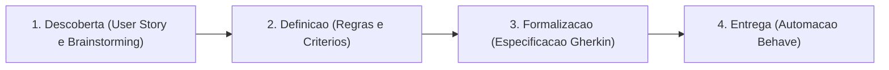
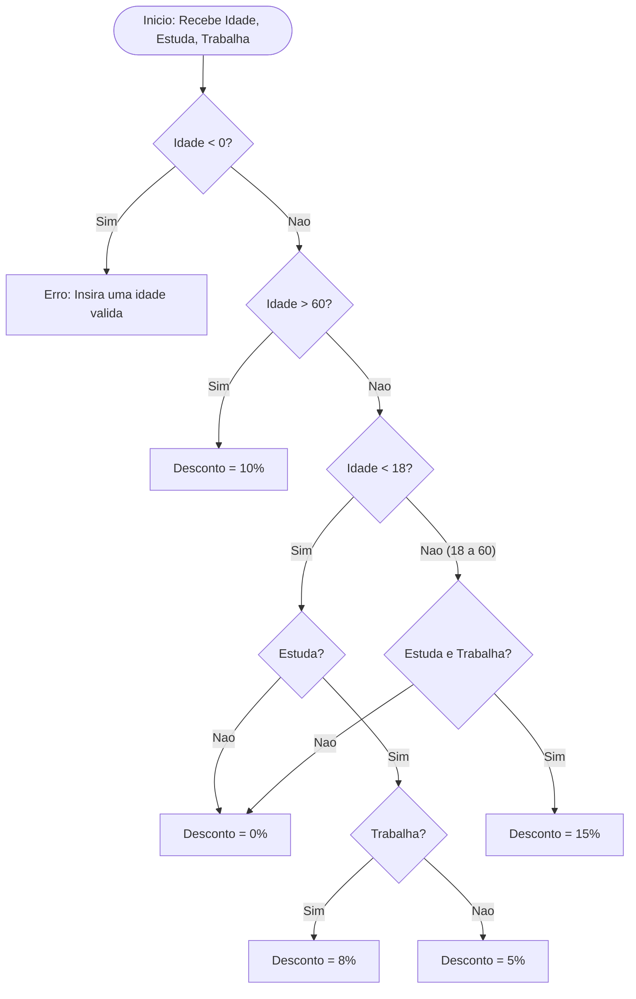
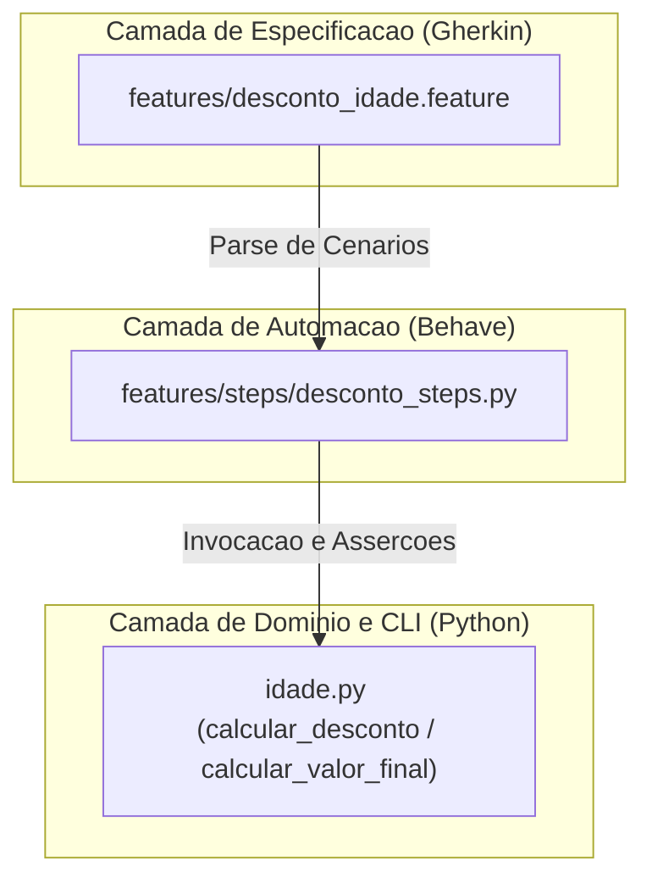

# Sistema de Calculo de Descontos por Idade e Ocupacao (BDD)


Especificacao, implementacao e automacao de testes orientados a comportamento (**Behavior-Driven Development - BDD**) para um motor de calculo de descontos progressivos baseado em faixa etaria e vinculo de ocupacao (estudo e trabalho).

Projeto desenvolvido como atividade pratica da disciplina **Testes de Software** (Cap. 4: Cenarios e Casos de Testes com BDD), ministrada pelo Prof. Breno Romero no **Instituto Federal da Paraiba (IFPB) - Campus Campina Grande**.

---

## Sumario

1. [Fundamentacao Metodologica (BDD)](#1-fundamentacao-metodologica-bdd)
2. [Fluxo das 4 Fases do BDD](#2-fluxo-das-4-fases-do-bdd)
3. [Regras de Negocio e Arvore de Decisao](#3-regras-de-negocio-e-arvore-de-decisao)
4. [Fase 1 e 2: Descoberta, Definicao e Mapeamento de Exemplos](#4-fase-1-e-2-descoberta-definicao-e-mapeamento-de-exemplos)
5. [Fase 3: Formalizacao em Gherkin](#5-fase-3-formalizacao-em-gherkin)
6. [Fase 4: Arquitetura de Automacao e Execucao](#6-fase-4-arquitetura-de-automacao-e-execucao)
7. [Como Executar](#7-como-executar)

---

## 1. Fundamentacao Metodologica (BDD)

O **Behavior-Driven Development (BDD)** estabelece uma linguagem ubiqua entre desenvolvedores, analistas de qualidade (QA) e *stakeholders* de negocio, descrevendo o comportamento esperado do sistema sob a perspectiva do usuario antes ou durante a implementacao tecnica.

Principais diretrizes adotadas neste repositorio:
- **Foco em Comportamento:** Especificacao centrada no resultado observavel pelo cliente, desacoplada de detalhes internos de implementacao.
- **Documentacao Viva:** Os arquivos `.feature` atuam simultaneamente como requisito de negocio e suite de verificacao automatizada.
- **Rastreabilidade:** Cada regra de negocio possui correspondencia direta com cenarios estruturados no padrao `Given-When-Then` (`Dado-Quando-Entao`).

---

## 2. Fluxo das 4 Fases do BDD



---

## 3. Regras de Negocio e Arvore de Decisao

### Especificacao Normativa

| ID | Condicao de Entrada | Percentual de Desconto |
| :--- | :--- | :--- |
| **RN01** | Idade menor que 18 anos e apenas estudante (`estuda = True`, `trabalha = False`) | **5%** |
| **RN02** | Idade menor que 18 anos, estuda e trabalha (`estuda = True`, `trabalha = True`) | **8%** |
| **RN03** | Idade entre 18 e 60 anos e apenas estudante (`estuda = True`, `trabalha = False`) | **0% (Sem desconto)** |
| **RN04** | Idade entre 18 e 60 anos, estuda e trabalha (`estuda = True`, `trabalha = True`) | **15%** |
| **RN05** | Idade maior que 60 anos (independente de ocupacao) | **10%** |
| **RN06** | Idade menor que 0 (invalida) | **Excecao (`Insira uma idade valida`)** |

### Fluxograma de Decisao do Motor de Descontos



---

## 4. Fase 1 e 2: Descoberta, Definicao e Mapeamento de Exemplos

### Historia de Usuario (*User Story*)

> **Como** cliente da loja,  
> **Quero** que o sistema calcule automaticamente meu percentual de desconto com base na minha idade e ocupacao,  
> **Para que** eu pague o valor final correto de acordo com as politicas comerciais vigentes.

### Mapeamento de Exemplos (*Example Mapping*)

Considerando o valor base do produto fixado em `R$ 100,00`:

| ID | Cenario de Exemplo | Entrada (`idade`, `estuda`, `trabalha`) | Regra Associada | Resultado Esperado |
| :--- | :--- | :--- | :--- | :--- |
| **CT01** | Menor de idade que apenas estuda | `16`, `"sim"`, `"nao"` | RN01 | Desconto de `5%` / Valor final `R$ 95,00` |
| **CT02** | Menor de idade que estuda e trabalha | `17`, `"sim"`, `"sim"` | RN02 | Desconto de `8%` / Valor final `R$ 92,00` |
| **CT03** | Adulto (18-60) que apenas estuda | `25`, `"sim"`, `"nao"` | RN03 | Desconto de `0%` / Valor final `R$ 100,00` |
| **CT04** | Adulto (18-60) que estuda e trabalha | `30`, `"sim"`, `"sim"` | RN04 | Desconto de `15%` / Valor final `R$ 85,00` |
| **CT05** | Pessoa acima de 60 anos | `65`, `"nao"`, `"nao"` | RN05 | Desconto de `10%` / Valor final `R$ 90,00` |
| **CT06** | Tentativa com idade negativa | `-5`, `-`, `-` | RN06 | Mensagem `"Insira uma idade valida"` |

---

## 5. Fase 3: Formalizacao em Gherkin

Os cenarios seguem a estrutura **Contexto (`Given`) - Acao (`When`) - Resultado (`Then`)**, implementados em [`features/desconto_idade.feature`](features/desconto_idade.feature):

```gherkin
Feature: Calculo de Desconto por Idade e Ocupacao
  Como cliente da loja
  Quero receber descontos de acordo com minha idade e ocupacao (estudo e trabalho)
  Para pagar um valor justo na compra do produto

  Scenario: Menor de 18 anos que apenas estuda recebe 5% de desconto
    Given que o sistema de cálculo de descontos está pronto com produto no valor de 100.00
    When informo a idade 16, estuda "sim" e trabalha "não"
    Then o desconto aplicado deve ser de 5% e o valor final deve ser 95.00

  Scenario: Menor de 18 anos que estuda e trabalha recebe 8% de desconto
    Given que o sistema de cálculo de descontos está pronto com produto no valor de 100.00
    When informo a idade 17, estuda "sim" e trabalha "sim"
    Then o desconto aplicado deve ser de 8% e o valor final deve ser 92.00

  Scenario: Pessoa entre 18 e 60 anos que apenas estuda não recebe desconto
    Given que o sistema de cálculo de descontos está pronto com produto no valor de 100.00
    When informo a idade 25, estuda "sim" e trabalha "não"
    Then o desconto aplicado deve ser de 0% e o valor final deve ser 100.00

  Scenario: Pessoa entre 18 e 60 anos que estuda e trabalha recebe 15% de desconto
    Given que o sistema de cálculo de descontos está pronto com produto no valor de 100.00
    When informo a idade 30, estuda "sim" e trabalha "sim"
    Then o desconto aplicado deve ser de 15% e o valor final deve ser 85.00

  Scenario: Pessoa com mais de 60 anos recebe 10% de desconto
    Given que o sistema de cálculo de descontos está pronto com produto no valor de 100.00
    When informo a idade 65, estuda "não" e trabalha "não"
    Then o desconto aplicado deve ser de 10% e o valor final deve ser 90.00

  Scenario: Tentar calcular desconto com idade inválida (negativa)
    Given que o sistema de cálculo de descontos está pronto com produto no valor de 100.00
    When tento informar uma idade inválida -5
    Then uma mensagem de erro "Insira uma idade válida" deve ser exibida
```

---

## 6. Fase 4: Arquitetura de Automacao e Execucao

### Diagrama de Componentes do Projeto



### Mapeamento de Arquivos

| Arquivo | Responsabilidade |
| :--- | :--- |
| [`idade.py`](idade.py) | Implementacao das funcoes puras de calculo (`calcular_desconto`, `calcular_valor_final`) e interface de linha de comando (`main`). |
| [`features/desconto_idade.feature`](features/desconto_idade.feature) | Especificacao executavel em linguagem Gherkin contendo os 6 cenarios de aceite. |
| [`features/steps/desconto_steps.py`](features/steps/desconto_steps.py) | Definicao dos *step bindings* (`@given`, `@when`, `@then`) para execucao automatizada pelo Behave. |
| [`requirements.txt`](requirements.txt) | Declaracao de dependencias de teste (`behave>=1.2.6`). |

---

## 7. Como Executar

### Pre-requisitos
- Python `3.10+`
- `pip` ou `uv`

### Instalacao do Ambiente

```bash
git clone https://github.com/Rodriguesmath/Sistema-calcula-idade.git
cd Sistema-calcula-idade
python3 -m venv .venv
source .venv/bin/activate
pip install -r requirements.txt
```

### Execucao da Suite de Testes BDD

```bash
behave
```

Saida esperada da verificacao:

```text
1 feature passed, 0 failed, 0 skipped
6 scenarios passed, 0 failed, 0 skipped
18 steps passed, 0 failed, 0 skipped
```

### Execucao Interativa (CLI)

```bash
python3 idade.py
```
